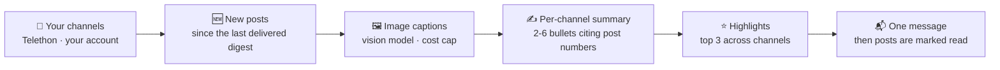

<!-- mcp-name: io.github.AndreySukhanov/summarix-telegram -->
<div align="center">


# 📰 Summarix

### Your Telegram channels, read for you — one short digest a day, every point linked to its post.

**English** | [Русский](README.ru.md)

**Summarix is a self-hosted Telegram channel summarizer**: a Telegram bot, a Claude Code plugin and an MCP server that summarize the Telegram channels you follow with AI — private channels included — into one short digest, with a link to every post.

**Not "another summary bot."** Summarix reads the channels you follow through *your own* account — private channels and albums included — captions the images, summarizes each channel in a few cited bullets, picks the day's highlights, and sends you one message. Every point links back to the post it came from, and a model-invented URL cannot appear.

**Your channels → new posts → image captions → 2-6 cited bullets per channel → top highlights → one message. Self-hosted. A few cents a day.**

[](https://github.com/AndreySukhanov/summarix-telegram/actions/workflows/ci.yml)
[](https://www.python.org/)
[](https://pypi.org/project/summarix-telegram/)
[](https://docs.aiogram.dev/)
[](https://docs.telethon.dev/)
[](#-quick-start)
[](CONTRIBUTING.md)
[](LICENSE)

[Quick Start](#-quick-start) · [Three ways](#-three-ways-to-use-it) · [What you get](#-what-you-get) · [How It Works](#️-how-it-works) · [Features](#-features) · [Commands](#-commands) · [Claude Code plugin](#-claude-code-plugin) · [MCP server](#-mcp-server) · [FAQ](#-faq) · [Privacy](#-privacy-and-security)

</div>

---

## 💡 The Problem

You follow thirty channels because each of them is sometimes worth it. In practice that means unread counters in the hundreds, the one post that mattered buried between ads and cross-promotion, and an hour a day of scrolling to find out that most of it was not news.

Summary bots promise to fix this and run into the same walls: they cannot read private channels, they skip images and charts, they lose posts when something fails, and their summaries come with no way to check what they are based on.

**Summarix reads everything you follow and hands you the part worth your time — with the receipts.**

---

## 🔥 Why it wins

| | Scrolling, or a typical digest tool | **Summarix** |
|---|---|---|
| **One story, five channels** | The same news five times, once per channel | **By topic**: one point linked to every channel's post — and the code rejects a grouping that drops a cited fact or adds a post |
| **Trust** | The model writes the links, or there is one link per channel | **Every bullet cites post numbers and the code builds the links**, so a made-up URL cannot appear |
| **Images and charts** | Skipped, or a `[photo]` placeholder | **Captioned by a vision model** — including posts that are only a picture — with a per-run cost cap |
| **Failures** | A fixed time window: a failed or late run lets posts slip through | **Read marks move only after delivery**; a backlog arrives oldest first, a broken channel is listed, not fatal |
| **Noise** | Every giveaway and promo, retold | **`/mute giveaway, crypt`** — muted posts never reach the model and cost nothing |
| **Voice** | One neutral tone | **13 styles** plus your own prompt, summaries in **5 languages** |
| **Discovery** | Only the channels you already know | **`/find`** live new channels with subscribers, posts a month and share on the topic; **`/search`** across your channels with query expansion |
| **Private channels** | Hosted digest bots: public ones, private only on paid plans | **Reads through your own account** (Telethon) — private channels and albums, free |
| **Where it runs** | A bot, or a script | **One engine, four ways**: Telegram bot, Claude Code plugin with an optional panel, MCP server, CLI — a ready Docker image or `pipx` |
| **Cost and data** | Your feed on someone else's server | **Self-hosted**: SQLite with names and read marks only, any OpenAI-compatible model or a local one; every digest can land in your Obsidian vault as Markdown |

---

## 🎬 What you get

An illustrative digest (channels and news are made up):

```
Digest · 13.09.2026
Channels with news: 3 · posts: 27

Highlights
• OpenAI shipped a cheaper vision model (AI Weekly)
• Central bank kept the key rate at 16% (Markets)
• ...

AI Weekly
• A new small vision model is priced 4x below the previous one; benchmarks in the post show it on par for OCR (1, 4)
• Two posts about an agent framework release - mostly a changelog (2, 3)

Markets
• ...
```

Numbers in brackets are links to the posts. The model only cites post numbers; the bot turns them into links. **You can check every line in one tap.**

---

## ⚙️ How It Works



<details>
<summary><b>One run, step by step</b></summary>

```
every day at DIGEST_TIME                      /digest, /digest 48
          │                                          │
          ▼                                          ▼
   for each channel: new posts since the last delivered digest
          │   Telethon, your account (private channels, albums)
          ▼
   images ──▶ vision model: one-line caption   (capped per run)
          ▼
   posts + captions ──▶ model: 2-6 bullets citing [post numbers]
          ▼
   2+ channels ──▶ model: top 3 highlights
          ▼
   HTML message(s) to you ──▶ only then posts are marked read
```

</details>

- **Nothing is lost on failure.** Read marks move after the digest is delivered. A crash, an API error or a failed send means the same posts come next time.
- **One broken channel does not break the digest.** It is listed at the bottom as "could not read".
- **Ads and cross-promotion are skipped** by the summary prompt.

**Built to be trusted on a bad day, not just on a demo.**

---

## ✨ Features

| | Feature | How it works |
|---|---|---|
| 📡 | **Reads as you** | Telethon on your own account: public and private channels, albums as one post. Read-only — it never posts, joins or leaves |
| 🔗 | **Cited bullets** | The model cites post numbers only; the bot renders them as links, so every claim points to its source |
| 🖼 | **Image captions** | Photos and charts get a one-line caption from a vision model (a separate cheaper one if you like), capped per run |
| ⭐ | **Highlights** | With news from two or more channels, the top three items lead the digest |
| 🧩 | **By topic** | One story from several channels becomes one point, linked to every channel's post. The code checks the grouping — every cited fact stays, no post is added — and sends the digest by channel if the check fails |
| 🔇 | **Word filter** | `/mute giveaway, crypt` keeps posts with those words out; a word matches from its start, so «crypt» also mutes «cryptocurrency». Muted posts cost nothing and count as read |
| 📝 | **Markdown export** | Set `DIGEST_EXPORT_DIR` and each digest with news is also saved as a Markdown file — into an Obsidian vault or a synced notes folder, links to the posts kept |
| 🎭 | **13 styles + your prompt** | Digest, Explainer, Insights, TL;DR, ELI5, Storytime, HotTake, Twist, Vibes, Meme, Conspiracy, Roast, Rick — or write your own prompt |
| 🌍 | **5 languages** | Summaries in Russian, English, Spanish, French or Kazakh, whatever language the channels write in; the interface speaks the same five |
| 📁 | **Groups from folders** | Send a `t.me/addlist/…` folder link: its channels become a group with its own digest, next to "My channels" |
| 🔍 | **`/search`** | What your channels wrote about a topic: the model widens the query with word forms and synonyms and drops hits where a word matched in another sense |
| 🧭 | **`/find`** | New public channels on a topic — only live ones that actually write about it, with subscribers, posts a month and share of posts on the topic; ➕ adds one |
| ⏰ | **Daily schedule** | Your time and timezone, set from `/settings`; no Celery, no Redis |
| 🧱 | **Never loses posts** | Read marks only after delivery; a backlog over the per-channel limit arrives oldest first over the next digests |
| 🔐 | **Owner only** | Every update from anyone but `OWNER_ID` is dropped before any handler runs |
| 🤖 | **Claude Code plugin** | Two commands install the `summarix-telegram` skill: your channels retold right in Claude Code, with its own session and channel list, so the bot's digest misses nothing |
| 🔌 | **MCP server** | `scripts/mcp_server.py`: the same collector as eight tools for any MCP client — Claude Desktop, Cursor, Claude Code |

---

## 🧭 Three ways to use it

One engine underneath — Summarix reads your channels through your own account with Telethon. The three ways differ in who writes the retelling and where you read it.

| | Bot | Claude Code skill | MCP server |
|---|---|---|---|
| **Where you read** | A chat with your bot in Telegram | Claude Code | Any MCP client — Claude Desktop, Cursor, Claude Code |
| **Who writes the retelling** | The bot, with a model on your key (`LLM_API_KEY`) | Claude — no model key | The client's model — no model key |
| **When** | On its own, every day at your time, plus `/digest` | When you ask in plain words: "digest for 3 days" | When the client calls `fetch_posts`, `search_posts`… |
| **Read marks** | Moves them: the next digest starts where this one ended | Untouched — reads a window of N hours | Untouched, like the skill |
| **Setup** | Docker or `python run_bot.py`, a bot token, `OWNER_ID` | Two `/plugin` commands | One `claude mcp add`, or a few lines in Claude Desktop's config |
| **Best for** | Getting the digest without opening anything | Working in Claude Code: "what's new", follow-ups on the spot | Another client, or tools of your own |

Under the skill and the MCP server sits `scripts/tgdigest.py` — a CLI you can also run yourself. The bot has its own session and channel list; the skill and the MCP server share one, one process at a time, guarded by an OS file lock.

**Run all three: the bot sends the morning digest, and Claude answers "what did my channels say about smart glasses this month".**

---

## 🚀 Quick Start

You need four things:

| What | Where |
|---|---|
| `BOT_TOKEN` | [@BotFather](https://t.me/BotFather) → `/newbot`. The chat with this bot is where digests arrive. |
| `OWNER_ID` | [@userinfobot](https://t.me/userinfobot). Everyone else is ignored. |
| `TG_API_ID`, `TG_API_HASH` | [my.telegram.org](https://my.telegram.org) → API development tools. Lets the bot read channels as you. |
| `LLM_API_KEY`, `LLM_MODEL` | OpenAI, OpenRouter, DeepSeek, Qwen or any OpenAI-compatible API. The model must accept images, or set `DESCRIBE_IMAGES=false`. |

```bash
# 1) Clone
git clone https://github.com/AndreySukhanov/summarix-telegram.git
cd summarix-telegram

# 2) Keys
cp .env.example .env            # fill in the keys

# 3) Once: log in to your Telegram account (phone, code, 2FA password)
docker compose run --rm bot python -m scripts.login

# 4) Run
docker compose up -d
```

Docker pulls the ready image `ghcr.io/andreysukhanov/summarix-telegram` (amd64 and arm64: a VPS, a Raspberry Pi, a Mac) — nothing to build. `docker compose build` builds it from source instead.

Without Docker, as one command: `pipx install summarix-telegram`, then in a folder with your `.env` run `summarix-login` once and `summarix-bot` (or point `SUMMARIX_HOME` at that folder). From a clone: `pip install -r requirements.txt`, then `python -m scripts.login` and `python run_bot.py`. On Windows, `start_bot.bat` starts it and refuses to start a second copy.

Then open your bot, press Start, and add channels.

---

## 💬 Commands

| Command | What it does |
|---|---|
| `/add @channel https://t.me/other t.me/+invite` | Add one or several channels. Forwarding any post from a channel works too, and a `t.me/addlist/…` folder link adds the whole folder as a group |
| `/channels` | Groups and their channels; tap a channel to remove it, ➕ to add one to a group |
| `/remove @channel` or a `t.me` link | Remove |
| `/digest` | Digest of unread posts right now (marks them read) |
| `/digest 48` | Recap of the last 48 hours, marks nothing |
| `/search smart glasses 14` | What your channels wrote about a topic in the last 14 days (30 by default) |
| `/find smart glasses` | New live public channels on a topic, with stats |
| `/settings` | Style, custom prompt, digest language, interface language, time, timezone, layout (by channel or by topic), word filter |
| `/mute giveaway, promo, crypt` | Skip posts with these words; `/mute off` turns the filter off |
| `/status` | Model, next scheduled digest, last run with post/image/token counts |

The bot menu has buttons for all of it — a digest per group, a style switch, the channel list.

<details>
<summary><b>🔧 Configuration</b></summary>

All optional, in `.env`. Time, timezone and languages are starting values — change them any time in `/settings`.

| Variable | Default | |
|---|---|---|
| `DIGEST_TIME` / `TIMEZONE` | `09:00` / `Europe/Moscow` | When the daily digest arrives |
| `DIGEST_LANGUAGE` | `ru` | `ru`, `en`, `es`, `fr` or `kk` — language of the summaries, whatever the channels are in |
| `UI_LANGUAGE` | `ru` | Same five, for bot messages and buttons |
| `LLM_BASE_URL` | OpenAI | e.g. `https://openrouter.ai/api/v1` |
| `VISION_MODEL` | `LLM_MODEL` | A separate, cheaper model for image captions |
| `DESCRIBE_IMAGES` | `true` | Caption photos, including posts that are only a picture or a chart |
| `MAX_IMAGES_PER_RUN` | `20` | Cost cap: images beyond this are skipped |
| `LOOKBACK_HOURS` | `24` | How far back the first digest of a newly added channel looks |
| `MAX_POSTS_PER_CHANNEL` | `60` | Upper bound per channel per digest; a bigger backlog arrives oldest first over the next digests, nothing is skipped |
| `DIGEST_EXPORT_DIR` | — | A folder for a Markdown copy of each digest with news (an Obsidian vault, a notes folder). In Docker, `exports` is `./exports` next to the compose file |

</details>

---

## 🤖 Claude Code plugin

Read your channels without leaving the terminal. Summarix ships as a Claude Code plugin with a `summarix-telegram` skill: ask in plain words — "digest of my channels for 3 days", "roast style, last week", "what did my channels say about smart glasses", "find channels about AI agents" — and Claude collects the posts, retells them with a link to every post and answers follow-ups.

```
/plugin marketplace add AndreySukhanov/summarix-telegram
/plugin install summarix-telegram@summarix-telegram
```

Prefer a plain skill without the plugin? Copy `skills/summarix-telegram` into `~/.claude/skills/` - it is the same file.

The skill works on your clone of this repo: set `SUMMARIX_HOME` to it (or tell Claude once where it is), put `TG_API_ID` / `TG_API_HASH` in `.env`, and run the one-time login in your own terminal — `python scripts/tgdigest.py login`. No model key needed: Claude writes the digest itself, in any of the 13 styles.

It has its own Telegram session and its own channel list, and it only reads a recent window — it never moves the bot's read marks. **Run the bot and the plugin side by side; nothing collides.**

### 🪟 The digest beside the chat (optional mod)

On Claude Code 2.1.287 or later, one more install gives the digest a pane of its own:

```
/plugin install summarix-panel@summarix-telegram
```

When the skill finishes a digest, Claude also puts it in the pane - every point still linked to its post. **< Older / Newer >** page through the last 10 digests, kept across sessions; **24 h / 3 days / Week** ask for a new one in one press; `/summarix-panel` opens the pane at any time. The mod needs no keys and reads nothing from Telegram itself. Details: [`mods/summarix-panel`](mods/summarix-panel).

<details>
<summary><b>Script commands behind the skill</b></summary>

```bash
python scripts/tgdigest.py login                    # once: phone, code, 2FA
python scripts/tgdigest.py add t.me/addlist/slug    # a folder, @name, t.me/name, t.me/+invite
python scripts/tgdigest.py fetch --hours 24 --style tldr
python scripts/tgdigest.py search "smart glasses" --days 30
python scripts/tgdigest.py find "smart glasses" --top 10
python scripts/tgdigest.py styles
```

</details>

## 🔌 MCP server

Not on Claude Code? The same collector runs as an MCP server, so any MCP client — Claude Desktop, Cursor, Claude Code — gets your channels as tools. The client's model writes the digest; the server needs no model key.

```bash
# Claude Code
claude mcp add summarix-telegram -- /path/to/summarix-telegram/.venv/bin/python /path/to/summarix-telegram/scripts/mcp_server.py
```

Claude Desktop, in `claude_desktop_config.json`:

```json
{
  "mcpServers": {
    "summarix-telegram": {
      "command": "/path/to/summarix-telegram/.venv/bin/python",
      "args": ["/path/to/summarix-telegram/scripts/mcp_server.py"]
    }
  }
}
```

On Windows the interpreter is `.venv\Scripts\python.exe`.

Installed with `pipx install summarix-telegram`? Then the server is one command, and `SUMMARIX_HOME` is the folder with your `.env` and `data/`:

```bash
claude mcp add summarix-telegram -e SUMMARIX_HOME=/path/to/folder -- summarix-mcp
```

From the [MCP Registry](https://registry.modelcontextprotocol.io) (`io.github.AndreySukhanov/summarix-telegram`): a client that runs local stdio servers starts it with `uvx` — install [uv](https://docs.astral.sh/uv/) once, the rest is fetched on first run. Log in once with `uvx --from summarix-telegram tgdigest login` and the same `SUMMARIX_HOME`:

```json
{
  "mcpServers": {
    "summarix-telegram": {
      "command": "uvx",
      "args": ["summarix-telegram"],
      "env": { "SUMMARIX_HOME": "/path/to/folder" }
    }
  }
}
```

| Tool | What it does |
|---|---|
| `fetch_posts` | Posts of the last N hours from your list, with a style; a big issue comes in parts |
| `read_part` | The next part of the last fetch or search — without collecting again |
| `search_posts` | What your channels wrote about a topic |
| `find_channels` | Live new channels on a topic, with real stats |
| `list_channels` · `add_channels` · `remove_channels` | Manage the list; Telegram folders stay in sync |
| `list_styles` | The 13 styles |

It shares the session and the channel list with the skill - one process at a time, guarded by an OS file lock. Log in once in your own terminal with `python scripts/tgdigest.py login` — the login never goes through MCP. Every result with posts is marked as untrusted content: a post is data, not instructions.

**One server, any MCP client, your channels.**

---

## 💸 Cost

Per digest: one call per image (sent at low detail), one call per channel with news, one call for highlights. Twenty channels with a few posts each and the image cap at 20 means about 40 calls a day; on a small model that is usually a few cents a day — `/status` shows the real token count.

**The cheapest hour you will save today.**

---

## 🔐 Privacy and security

- **The session file (`data/owner.session`) is full access to your Telegram account.** It stays on your machine, is git- and docker-ignored, and should never be shared or committed.
- The bot answers only `OWNER_ID`; every other update is dropped before any handler runs.
- The account is used read-only: it never posts, joins or leaves anything. Channels behind an invite link must be joined by you first.
- Post texts and images are sent to the model provider you configure. Pick one whose data policy you accept, or point `LLM_BASE_URL` at a local model.
- Storage is a local SQLite file with channel names, groups and read marks only; post contents are not stored.

**Your feed stays yours: nothing leaves your machine except what you send to the model you chose.**

<details>
<summary><b>📁 Project layout</b></summary>

```
summarix_telegram/
  bot/
    main.py           wiring: settings, SQLite, Telethon, model, bot, scheduler, "/" menu
    handlers.py       commands, groups, digest per group, search and find
    settings_menu.py  /settings: style, prompt, languages, time, timezone, layout, word filter
    keyboards.py      reply and inline keyboards
    middlewares.py    owner-only gate
    texts.py          interface strings in five languages
  services/
    reader.py         Telethon: resolve channels and folders, fetch posts, albums, photos
    llm.py            prompts: image captions, channel summary, highlights, grouping by topic
    styles.py         13 styles, each with a prompt per digest language
    digest.py         build a digest by channel or by topic, mark read after delivery
    export.py         a Markdown copy of each digest with news
    search.py         /search query expansion and /find channel discovery
    scheduler.py      daily run in your timezone
    refs.py           parse @name, t.me links, invite and folder links
  database/           channels, groups, digest runs, settings
  scripts/
    login.py          one-time account login
    tgdigest.py       collector behind the Claude Code skill
    mcp_server.py     MCP server: the collector as tools
  utils/text.py       citations → links, safe HTML, splitting at 4096 chars, the word filter
  cli.py              summarix-bot and summarix-login of the pipx package
scripts/              the old paths keep working: scripts/tgdigest.py, scripts/mcp_server.py, python -m scripts.login
skills/summarix-telegram/  the Claude Code skill
mods/summarix-panel/  the optional panel mod for Claude Code
.claude-plugin/     plugin and marketplace manifests
tests/              offline: fake Telegram reader and fake model

```

</details>

---

## 🧪 Tests

```bash
pip install -r requirements.txt
pytest
```

**140 tests, no network**: link and folder parsing, album grouping, citation linking and HTML escaping, message splitting, schedule in local time, read marks only after commit, recap windows, image cost cap, broken channels, groups, search and discovery, settings, the tgdigest companion, the MCP server (schemas and bounds, parts that fit, no stale results, locks that survive cancellation, safe errors, an isolated protocol stream), owner-only access. CI runs them with a flake8 pass on every push to main.

## ❓ FAQ

### How do I summarize Telegram channels with AI?
Run Summarix: add the channels you follow (`/add`, or a Telegram folder link) and the bot sends one digest a day — 2-6 bullets per channel, the day's highlights first, every bullet linked to its post. `/digest` gives one on demand.

### Can it merge the same news from several channels?
Yes. In `/settings` choose **Layout → By topic**: a story told by three channels becomes one point with links to all three posts. The code checks the grouping — every cited fact must stay and no post may be added — and sends the digest by channel if the check fails twice.

### Can it summarize private Telegram channels?
Yes. It reads through your own Telegram account (Telethon), so any channel you have joined works, private ones included. A regular bot cannot do that on its own.

### Is there an MCP server for Telegram channels?
Yes — `scripts/mcp_server.py` gives any MCP client (Claude Desktop, Cursor, Claude Code) your channels as eight tools: fetch posts, read further parts, search, find new channels, manage the list. See [MCP server](#-mcp-server).

### Can I use it in Claude Code?
Yes — install the `summarix-telegram` plugin with two `/plugin` commands and ask in plain words: "digest of my channels for 3 days". See [Claude Code plugin](#-claude-code-plugin).

### Do I need an OpenAI API key?
For the bot, yes — any OpenAI-compatible API works: OpenAI, OpenRouter, DeepSeek, Qwen, or a local model behind `LLM_BASE_URL`. The Claude Code skill and the MCP server need no model key: the client's model writes the digest.

### Does it post, join or leave channels on my behalf?
No. The account is used read-only, and the bot answers only its owner (`OWNER_ID`).

### What does it cost?
Running it for yourself costs only model tokens — about 40 calls a day for twenty channels, usually a few cents on a small model. The code is Source-Available: free to read, run and learn from.

### Which languages does it support?
Summaries in Russian, English, Spanish, French and Kazakh, whatever language the channels write in; the bot interface speaks the same five.

### What does it store?
A local SQLite file with channel names, groups and read marks. Post contents are not stored.

---

## 🤝 Contributing

The bot is built from small, replaceable parts. Great first contributions:

- A new digest style — one entry in `summarix_telegram/services/styles.py`
- A new language — interface strings in `summarix_telegram/bot/texts.py`, a prompt per style
- A reader feature, tested against the fake Telegram client in `tests/fakes.py`

See [CONTRIBUTING.md](CONTRIBUTING.md). Open an issue first for bigger changes — happy to discuss the design.

---

## ⭐ Support the project

If this project saved you time or showed you something new — **star it**. It genuinely helps others discover it.

### 💜 Sponsor development

This is a self-funded project — every digest, caption and search runs on paid model APIs, and every new style is tested on real channels before it ships. A donation goes straight into model credits and new features.

<table>
<tr>
<td valign="top">

**USDT — TRC-20 (Tron network)**

```
TERj89Gjf4qsMW7xyKQWGWtNmBQaDUPnnH
```

> ⚠️ Send **only USDT via the TRC-20 (Tron)** network to this address. Funds sent through any other network will be lost.

</td>
<td valign="top">

</td>
</tr>
</table>

Thank you — even a small contribution keeps the digests coming. 🙏

---

## 📄 License

**Source-Available** — free to read, run and learn from. Commercial or derivative use requires written permission. See [LICENSE](LICENSE).

Licensing contact: [avsukhanov21@gmail.com](mailto:avsukhanov21@gmail.com)

---

<div align="center">

**Built with Python + aiogram + Telethon + any OpenAI-compatible model**

[GitHub](https://github.com/AndreySukhanov) · [LinkedIn](https://www.linkedin.com/in/andrei-sukhanov-2605821b9) · [Email](mailto:avsukhanov21@gmail.com)

</div>
