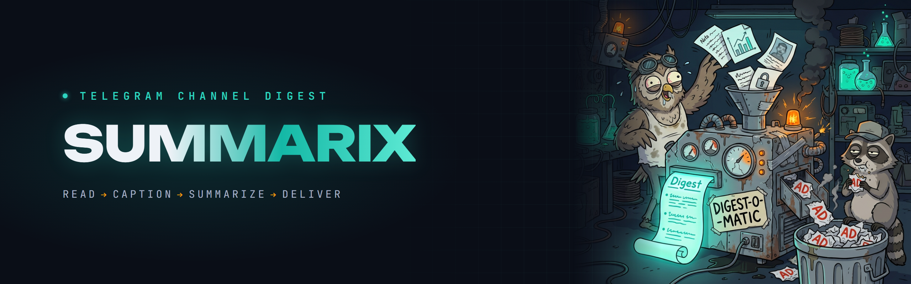
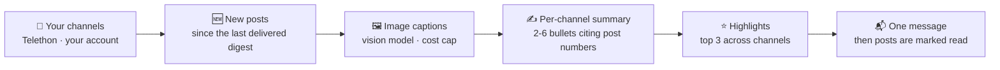
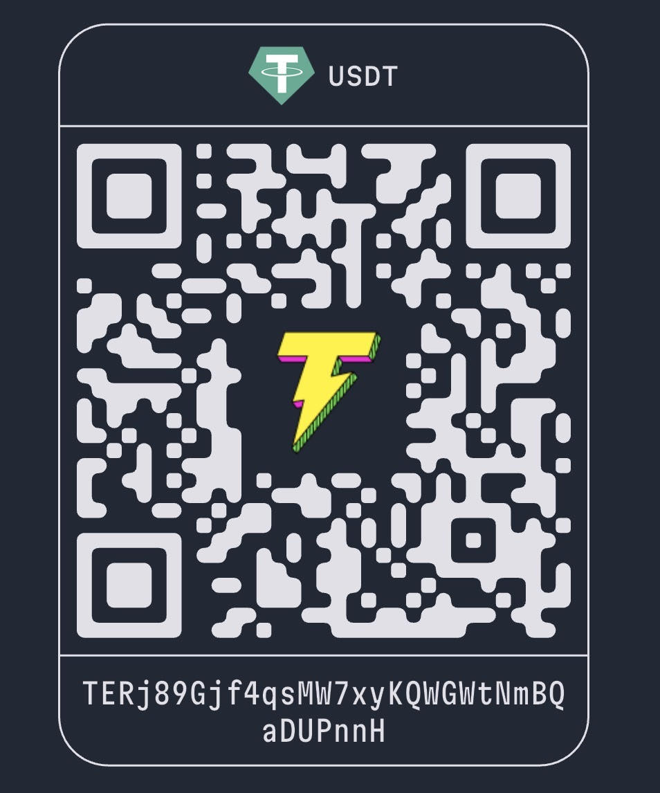

<div align="center">



# 📰 Summarix

### Your Telegram channels, read for you — one short digest a day, every point linked to its post.

**Not "another summary bot."** Summarix reads the channels you follow through *your own* account — private channels and albums included — captions the images, summarizes each channel in a few cited bullets, picks the day's highlights, and sends you one message. Every point links back to the post it came from, and a model-invented URL cannot appear.

**Your channels → new posts → image captions → 2-6 cited bullets per channel → top highlights → one message. Self-hosted. A few cents a day.**

[](https://github.com/AndreySukhanov/summarix-telegram/actions/workflows/ci.yml)
[](https://www.python.org/)
[](https://docs.aiogram.dev/)
[](https://docs.telethon.dev/)
[](#-quick-start)
[](CONTRIBUTING.md)
[](LICENSE)

[Quick Start](#-quick-start) · [What you get](#-what-you-get) · [How It Works](#️-how-it-works) · [Features](#-features) · [Commands](#-commands) · [Privacy](#-privacy-and-security)

</div>

---

## 💡 The Problem

You follow thirty channels because each of them is sometimes worth it. In practice that means unread counters in the hundreds, the one post that mattered buried between ads and cross-promotion, and an hour a day of scrolling to find out that most of it was not news.

Summary bots promise to fix this and run into the same walls: they cannot read private channels, they skip images and charts, they lose posts when something fails, and their summaries come with no way to check what they are based on.

**Summarix reads everything you follow and hands you the part worth your time — with the receipts.**

---

## 🔥 Why it wins

| | Scrolling, or a typical summary bot | **Summarix** |
|---|---|---|
| **Private channels** | A bot cannot join them | **Reads through your own account** (Telethon) — private channels and albums work |
| **Trust** | "Trust me" summaries | **Every bullet cites post numbers**; the bot turns them into links, so a made-up URL cannot appear |
| **Images and charts** | Skipped | **Captioned by a vision model** — including posts that are only a picture — with a per-run cost cap |
| **Failures** | A crash loses a day of posts | **Read marks move only after delivery**; a broken channel is listed, not fatal |
| **Voice** | One bland tone | **13 styles** plus your own prompt, summaries in **5 languages** |
| **Organization** | One endless list | **Groups** from your Telegram folders, with a separate digest per group |
| **Discovery** | — | **`/search`** across your channels with query expansion; **`/find`** live new channels with real stats |
| **Cost and data** | Your feed on someone else's server | **Self-hosted**: SQLite with names and read marks only, any OpenAI-compatible model — or a local one |

---

## 🎬 What you get

An illustrative digest (channels and news are made up):

```
Digest · 13.09.2026
Channels with news: 3 · posts: 27

Highlights
• OpenAI shipped a cheaper vision model (AI Weekly)
• Central bank kept the key rate at 16% (Markets)
• ...

AI Weekly
• A new small vision model is priced 4x below the previous one; benchmarks in the post show it on par for OCR (1, 4)
• Two posts about an agent framework release - mostly a changelog (2, 3)

Markets
• ...
```

Numbers in brackets are links to the posts. The model only cites post numbers; the bot turns them into links. **You can check every line in one tap.**

---

## ⚙️ How It Works



<details>
<summary><b>One run, step by step</b></summary>

```
every day at DIGEST_TIME                      /digest, /digest 48
          │                                          │
          ▼                                          ▼
   for each channel: new posts since the last delivered digest
          │   Telethon, your account (private channels, albums)
          ▼
   images ──▶ vision model: one-line caption   (capped per run)
          ▼
   posts + captions ──▶ model: 2-6 bullets citing [post numbers]
          ▼
   2+ channels ──▶ model: top 3 highlights
          ▼
   HTML message(s) to you ──▶ only then posts are marked read
```

</details>

- **Nothing is lost on failure.** Read marks move after the digest is delivered. A crash, an API error or a failed send means the same posts come next time.
- **One broken channel does not break the digest.** It is listed at the bottom as "could not read".
- **Ads and cross-promotion are skipped** by the summary prompt.

**Built to be trusted on a bad day, not just on a demo.**

---

## ✨ Features

| | Feature | How it works |
|---|---|---|
| 📡 | **Reads as you** | Telethon on your own account: public and private channels, albums as one post. Read-only — it never posts, joins or leaves |
| 🔗 | **Cited bullets** | The model cites post numbers only; the bot renders them as links, so every claim points to its source |
| 🖼 | **Image captions** | Photos and charts get a one-line caption from a vision model (a separate cheaper one if you like), capped per run |
| ⭐ | **Highlights** | With news from two or more channels, the top three items lead the digest |
| 🎭 | **13 styles + your prompt** | Digest, Explainer, Insights, TL;DR, ELI5, Storytime, HotTake, Twist, Vibes, Meme, Conspiracy, Roast, Rick — or write your own prompt |
| 🌍 | **5 languages** | Summaries in Russian, English, Spanish, French or Kazakh, whatever language the channels write in; the interface speaks the same five |
| 📁 | **Groups from folders** | Send a `t.me/addlist/…` folder link: its channels become a group with its own digest, next to "My channels" |
| 🔍 | **`/search`** | What your channels wrote about a topic: the model widens the query with word forms and synonyms and drops hits where a word matched in another sense |
| 🧭 | **`/find`** | New public channels on a topic — only live ones that actually write about it, with subscribers, posts a month and share of posts on the topic; ➕ adds one |
| ⏰ | **Daily schedule** | Your time and timezone, set from `/settings`; no Celery, no Redis |
| 🧱 | **Never loses posts** | Read marks only after delivery; a backlog over the per-channel limit arrives oldest first over the next digests |
| 🔐 | **Owner only** | Every update from anyone but `OWNER_ID` is dropped before any handler runs |
| 🤖 | **Claude Code companion** | `scripts/tgdigest.py` collects posts into Markdown for a Claude Code skill — its own session and channel list, so the bot's digest misses nothing |

---

## 🚀 Quick Start

You need four things:

| What | Where |
|---|---|
| `BOT_TOKEN` | [@BotFather](https://t.me/BotFather) → `/newbot`. The chat with this bot is where digests arrive. |
| `OWNER_ID` | [@userinfobot](https://t.me/userinfobot). Everyone else is ignored. |
| `TG_API_ID`, `TG_API_HASH` | [my.telegram.org](https://my.telegram.org) → API development tools. Lets the bot read channels as you. |
| `LLM_API_KEY`, `LLM_MODEL` | OpenAI, OpenRouter, DeepSeek, Qwen or any OpenAI-compatible API. The model must accept images, or set `DESCRIBE_IMAGES=false`. |

```bash
# 1) Clone
git clone https://github.com/AndreySukhanov/summarix-telegram.git
cd summarix-telegram

# 2) Keys
cp .env.example .env            # fill in the keys

# 3) Once: log in to your Telegram account (phone, code, 2FA password)
docker compose run --rm bot python -m scripts.login

# 4) Run
docker compose up -d
```

Without Docker: `pip install -r requirements.txt`, then `python -m scripts.login` and `python run_bot.py`. On Windows, `start_bot.bat` starts it and refuses to start a second copy.

Then open your bot, press Start, and add channels.

---

## 💬 Commands

| Command | What it does |
|---|---|
| `/add @channel https://t.me/other t.me/+invite` | Add one or several channels. Forwarding any post from a channel works too, and a `t.me/addlist/…` folder link adds the whole folder as a group |
| `/channels` | Groups and their channels; tap a channel to remove it, ➕ to add one to a group |
| `/remove @channel` or a `t.me` link | Remove |
| `/digest` | Digest of unread posts right now (marks them read) |
| `/digest 48` | Recap of the last 48 hours, marks nothing |
| `/search smart glasses 14` | What your channels wrote about a topic in the last 14 days (30 by default) |
| `/find smart glasses` | New live public channels on a topic, with stats |
| `/settings` | Style, custom prompt, digest language, interface language, time, timezone |
| `/status` | Model, next scheduled digest, last run with post/image/token counts |

The bot menu has buttons for all of it — a digest per group, a style switch, the channel list.

<details>
<summary><b>🔧 Configuration</b></summary>

All optional, in `.env`. Time, timezone and languages are starting values — change them any time in `/settings`.

| Variable | Default | |
|---|---|---|
| `DIGEST_TIME` / `TIMEZONE` | `09:00` / `Europe/Moscow` | When the daily digest arrives |
| `DIGEST_LANGUAGE` | `ru` | `ru`, `en`, `es`, `fr` or `kk` — language of the summaries, whatever the channels are in |
| `UI_LANGUAGE` | `ru` | Same five, for bot messages and buttons |
| `LLM_BASE_URL` | OpenAI | e.g. `https://openrouter.ai/api/v1` |
| `VISION_MODEL` | `LLM_MODEL` | A separate, cheaper model for image captions |
| `DESCRIBE_IMAGES` | `true` | Caption photos, including posts that are only a picture or a chart |
| `MAX_IMAGES_PER_RUN` | `20` | Cost cap: images beyond this are skipped |
| `LOOKBACK_HOURS` | `24` | How far back the first digest of a newly added channel looks |
| `MAX_POSTS_PER_CHANNEL` | `60` | Upper bound per channel per digest; a bigger backlog arrives oldest first over the next digests, nothing is skipped |

</details>

<details>
<summary><b>🤖 Claude Code companion: tgdigest</b></summary>

`scripts/tgdigest.py` is the Claude Code side of Summarix: it collects posts from a hand-picked channel list into a Markdown file, and Claude writes the digest from that file. It is kept apart from the bot on purpose — its own Telegram session (two processes on one session file trip over each other), its own channel list, and recap only: it moves no read marks, so the bot's daily digest misses nothing.

```bash
python scripts/tgdigest.py login                    # once: phone, code, 2FA
python scripts/tgdigest.py add t.me/addlist/slug    # a folder, @name, t.me/name, t.me/+invite
python scripts/tgdigest.py fetch --hours 24 --style tldr
python scripts/tgdigest.py search "smart glasses" --days 30
python scripts/tgdigest.py find "smart glasses" --top 10
python scripts/tgdigest.py styles
```

</details>

---

## 💸 Cost

Per digest: one call per image (sent at low detail), one call per channel with news, one call for highlights. Twenty channels with a few posts each and the image cap at 20 means about 40 calls a day; on a small model that is usually a few cents a day — `/status` shows the real token count.

**The cheapest hour you will save today.**

---

## 🔐 Privacy and security

- **The session file (`data/owner.session`) is full access to your Telegram account.** It stays on your machine, is git- and docker-ignored, and should never be shared or committed.
- The bot answers only `OWNER_ID`; every other update is dropped before any handler runs.
- The account is used read-only: it never posts, joins or leaves anything. Channels behind an invite link must be joined by you first.
- Post texts and images are sent to the model provider you configure. Pick one whose data policy you accept, or point `LLM_BASE_URL` at a local model.
- Storage is a local SQLite file with channel names, groups and read marks only; post contents are not stored.

**Your feed stays yours: nothing leaves your machine except what you send to the model you chose.**

<details>
<summary><b>📁 Project layout</b></summary>

```
bot/
  main.py           wiring: settings, SQLite, Telethon, model, bot, scheduler, "/" menu
  handlers.py       commands, groups, digest per group, search and find
  settings_menu.py  /settings: style, prompt, languages, time, timezone
  keyboards.py      reply and inline keyboards
  middlewares.py    owner-only gate
  texts.py          interface strings in five languages
services/
  reader.py         Telethon: resolve channels and folders, fetch posts, albums, photos
  llm.py            prompts: image captions, channel summary, highlights
  styles.py         13 styles, each with a prompt per digest language
  digest.py         build a digest, mark read after delivery
  search.py         /search query expansion and /find channel discovery
  scheduler.py      daily run in your timezone
  refs.py           parse @name, t.me links, invite and folder links
database/           channels, groups, digest runs, settings
scripts/
  login.py          one-time account login
  tgdigest.py       Claude Code companion
utils/text.py       citations → links, safe HTML, splitting at 4096 chars
tests/              offline: fake Telegram reader and fake model
```

</details>

---

## 🧪 Tests

```bash
pip install -r requirements.txt
pytest
```

**107 tests, no network**: link and folder parsing, album grouping, citation linking and HTML escaping, message splitting, schedule in local time, read marks only after commit, recap windows, image cost cap, broken channels, groups, search and discovery, settings, the tgdigest companion, owner-only access. CI runs them with a flake8 pass on every push to main.

---

## 🤝 Contributing

The bot is built from small, replaceable parts. Great first contributions:

- A new digest style — one entry in `services/styles.py`
- A new language — interface strings in `bot/texts.py`, a prompt per style
- A reader feature, tested against the fake Telegram client in `tests/fakes.py`

See [CONTRIBUTING.md](CONTRIBUTING.md). Open an issue first for bigger changes — happy to discuss the design.

---

## ⭐ Support the project

If this project saved you time or showed you something new — **star it**. It genuinely helps others discover it.

### 💜 Sponsor development

This is a self-funded project — every digest, caption and search runs on paid model APIs, and every new style is tested on real channels before it ships. A donation goes straight into model credits and new features.

<table>
<tr>
<td valign="top">

**USDT — TRC-20 (Tron network)**

```
TERj89Gjf4qsMW7xyKQWGWtNmBQaDUPnnH
```

> ⚠️ Send **only USDT via the TRC-20 (Tron)** network to this address. Funds sent through any other network will be lost.

</td>
<td valign="top">

</td>
</tr>
</table>

Thank you — even a small contribution keeps the digests coming. 🙏

---

## 📄 License

**Source-Available** — free to read, run and learn from. Commercial or derivative use requires written permission. See [LICENSE](LICENSE).

Licensing contact: [avsukhanov21@gmail.com](mailto:avsukhanov21@gmail.com)

---

<div align="center">

**Built with Python + aiogram + Telethon + any OpenAI-compatible model**

[GitHub](https://github.com/AndreySukhanov) · [LinkedIn](https://www.linkedin.com/in/andrei-sukhanov-2605821b9) · [Email](mailto:avsukhanov21@gmail.com)

</div>
