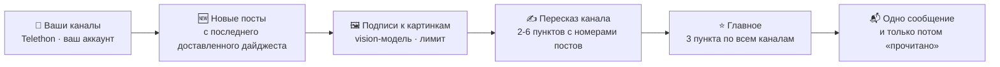
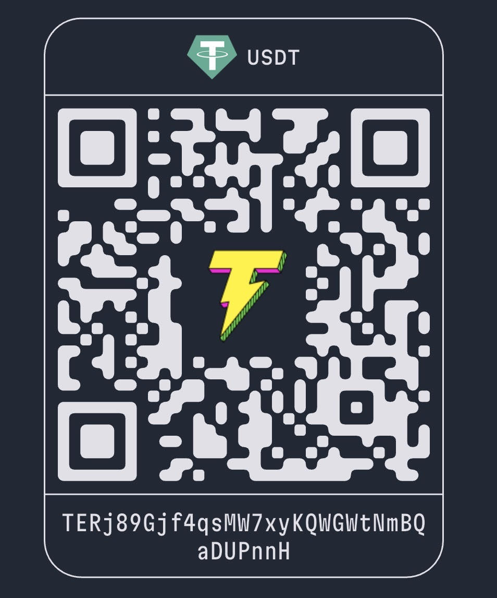

<div align="center">


# 📰 Summarix

### Ваши Telegram-каналы прочитаны за вас — один короткий дайджест в день, каждый пункт со ссылкой на пост.

[English](README.md) | **Русский**

**Summarix — self-hosted бот для саммари Telegram-каналов**: Telegram-бот, плагин для Claude Code и MCP-сервер, которые с помощью ИИ пересказывают каналы, на которые вы подписаны, — включая приватные — в один короткий дайджест со ссылкой на каждый пост.

**Не «ещё один бот-пересказчик».** Summarix читает каналы через *ваш собственный* аккаунт — приватные каналы и альбомы тоже, — подписывает картинки, пересказывает каждый канал в нескольких пунктах со ссылками, выбирает главное за день и присылает одно сообщение. Каждый пункт ведёт на пост, из которого он взят, а выдуманная моделью ссылка появиться не может.

**Ваши каналы → новые посты → подписи к картинкам → 2-6 пунктов со ссылками на канал → главное за день → одно сообщение. На своём сервере. Несколько центов в день.**

[](https://github.com/AndreySukhanov/summarix-telegram/actions/workflows/ci.yml)
[](https://www.python.org/)
[](https://docs.aiogram.dev/)
[](https://docs.telethon.dev/)
[](#-быстрый-старт)
[](CONTRIBUTING.md)
[](LICENSE)

[Быстрый старт](#-быстрый-старт) · [Три способа](#-три-способа-пользоваться) · [Что вы получаете](#-что-вы-получаете) · [Как это работает](#️-как-это-работает) · [Возможности](#-возможности) · [Команды](#-команды) · [Плагин для Claude Code](#-плагин-для-claude-code) · [MCP-сервер](#-mcp-сервер) · [Частые вопросы](#-частые-вопросы) · [Приватность](#-приватность-и-безопасность)

</div>

---

## 💡 Проблема

Вы подписаны на тридцать каналов, потому что каждый из них иногда того стоит. На деле это сотни непрочитанных, единственный важный пост, утонувший между рекламой и взаимопиаром, и час в день на пролистывание, чтобы выяснить, что новостей почти не было.

Боты-пересказчики обещают это исправить и упираются в одни и те же стены: не читают приватные каналы, пропускают картинки и графики, теряют посты при сбое, а их пересказ нечем проверить.

**Summarix читает всё, на что вы подписаны, и отдаёт ту часть, что стоит вашего времени, — со ссылками на источники.**

---

## 🔥 Почему это лучше

| | Листать самому или типичный бот-пересказчик | **Summarix** |
|---|---|---|
| **Приватные каналы** | Бот не может в них вступить | **Читает через ваш аккаунт** (Telethon) — приватные каналы и альбомы работают |
| **Доверие** | Пересказ «поверьте на слово» | **Каждый пункт ссылается на номера постов**; бот превращает их в ссылки, поэтому выдуманный URL появиться не может |
| **Картинки и графики** | Пропускаются | **Подписываются vision-моделью** — включая посты из одной картинки — с лимитом расходов на запуск |
| **Сбои** | Падение — и день постов потерян | **Отметки «прочитано» двигаются только после доставки**; сломанный канал попадает в список, а не роняет дайджест |
| **Подача** | Один скучный тон | **13 стилей** плюс свой промпт, пересказ на **5 языках** |
| **Порядок** | Один бесконечный список | **Группы** из ваших папок Telegram, у каждой свой дайджест |
| **Поиск** | — | **`/search`** по вашим каналам с расширением запроса; **`/find`** — живые новые каналы с реальной статистикой |
| **Деньги и данные** | Ваша лента на чужом сервере | **На своём сервере**: SQLite только с названиями и отметками, любая OpenAI-совместимая модель — или локальная |

---

## 🎬 Что вы получаете

Пример дайджеста (каналы и новости выдуманы):

```
Дайджест · 13.09.2026
Каналов с новостями: 3 · постов: 27

Главное
• OpenAI выпустила более дешёвую vision-модель (AI Weekly)
• ЦБ сохранил ключевую ставку 16% (Рынки)
• ...

AI Weekly
• Новая маленькая vision-модель в 4 раза дешевле прежней; по бенчмаркам в посте она не хуже в OCR (1, 4)
• Два поста про релиз фреймворка для агентов — в основном список изменений (2, 3)

Рынки
• ...
```

Числа в скобках — ссылки на посты. Модель указывает только номера постов, ссылки ставит бот. **Любую строку можно проверить в одно касание.**

---

## ⚙️ Как это работает



<details>
<summary><b>Один запуск по шагам</b></summary>

```
каждый день в DIGEST_TIME                     /digest, /digest 48
          │                                          │
          ▼                                          ▼
   по каждому каналу: новые посты с последнего доставленного дайджеста
          │   Telethon, ваш аккаунт (приватные каналы, альбомы)
          ▼
   картинки ──▶ vision-модель: подпись в одну строку   (лимит на запуск)
          ▼
   посты + подписи ──▶ модель: 2-6 пунктов с [номерами постов]
          ▼
   2+ канала ──▶ модель: 3 главных пункта
          ▼
   HTML-сообщение(я) вам ──▶ только потом посты отмечаются прочитанными
```

</details>

- **При сбое ничего не теряется.** Отметки двигаются после доставки дайджеста. Падение, ошибка API или неотправленное сообщение — и те же посты придут в следующий раз.
- **Один сломанный канал не ломает дайджест.** Он появляется внизу в строке «не прочитались».
- **Реклама и взаимопиар пропускаются** промптом пересказа.

**Сделано так, чтобы ему можно было доверять в плохой день, а не только на демо.**

---

## ✨ Возможности

| | Возможность | Как устроено |
|---|---|---|
| 📡 | **Читает от вашего имени** | Telethon на вашем аккаунте: публичные и приватные каналы, альбом — как один пост. Только чтение — ничего не публикует, никуда не вступает и не выходит |
| 🔗 | **Пункты со ссылками** | Модель указывает только номера постов, бот превращает их в ссылки — у каждого утверждения есть источник |
| 🖼 | **Подписи к картинкам** | Фото и графики получают подпись в одну строку от vision-модели (можно отдельной, подешевле), с лимитом на запуск |
| ⭐ | **Главное** | Если новости есть в двух и более каналах, дайджест открывают три главных пункта |
| 🎭 | **13 стилей + свой промпт** | Digest, Explainer, Insights, TL;DR, ELI5, Storytime, HotTake, Twist, Vibes, Meme, Conspiracy, Roast, Rick — или свой промпт |
| 🌍 | **5 языков** | Пересказ на русском, английском, испанском, французском или казахском — на каком бы языке ни писали каналы; интерфейс на тех же пяти |
| 📁 | **Группы из папок** | Пришлите ссылку на папку `t.me/addlist/…` — её каналы станут группой со своим дайджестом рядом с «Моими каналами» |
| 🔍 | **`/search`** | Что ваши каналы писали о теме: модель расширяет запрос формами слов и синонимами и отбрасывает совпадения не в том смысле |
| 🧭 | **`/find`** | Новые публичные каналы по теме — только живые и реально пишущие о ней, с подписчиками, числом постов за месяц и долей постов по теме; ➕ добавляет канал |
| ⏰ | **Расписание** | Ваше время и часовой пояс, настраиваются в `/settings`; без Celery и Redis |
| 🧱 | **Посты не теряются** | Отметки только после доставки; сверх лимита на канал посты придут в следующих дайджестах, от старых к новым |
| 🔐 | **Только владелец** | Любое сообщение не от `OWNER_ID` отбрасывается до обработчиков |
| 🤖 | **Плагин для Claude Code** | Две команды ставят скилл `summarix-telegram`: пересказ каналов прямо в Claude Code, со своей сессией и своим списком, поэтому дайджест бота ничего не теряет |
| 🔌 | **MCP-сервер** | `scripts/mcp_server.py`: тот же сборщик как восемь инструментов для любого MCP-клиента — Claude Desktop, Cursor, Claude Code |

---

## 🧭 Три способа пользоваться

Под капотом один движок — Summarix читает каналы через ваш аккаунт с помощью Telethon. Способы различаются тем, кто пишет пересказ и где вы его читаете.

| | Бот | Скилл для Claude Code | MCP-сервер |
|---|---|---|---|
| **Где читаете** | В чате с ботом в Telegram | В Claude Code | В любом MCP-клиенте — Claude Desktop, Cursor, Claude Code |
| **Кто пишет пересказ** | Бот, через модель по вашему ключу (`LLM_API_KEY`) | Claude — ключ модели не нужен | Модель клиента — ключ модели не нужен |
| **Когда** | Сам, каждый день в ваше время, плюс `/digest` | По просьбе словами: «дайджест за 3 дня» | Когда клиент вызывает `fetch_posts`, `search_posts`… |
| **Отметки «прочитано»** | Двигает: следующий дайджест начнётся с новых | Не трогает — читает окно за N часов | Не трогает, как скилл |
| **Установка** | Docker или `python run_bot.py`, токен бота, `OWNER_ID` | Две команды `/plugin` | Одна `claude mcp add` или несколько строк в конфиге Claude Desktop |
| **Кому подходит** | Хочется получать дайджест, ничего не открывая | Работаете в Claude Code: «что нового» и уточнения сразу | Другой клиент или свои инструменты |

Под скиллом и MCP-сервером лежит `scripts/tgdigest.py` — его можно запускать и самому. У бота своя сессия и свой список каналов; скилл и MCP-сервер делят один на двоих, по одному процессу за раз — это охраняет файловая блокировка ОС.

**Держите все три: бот присылает утренний дайджест, а Claude отвечает «что мои каналы писали про умные очки за месяц».**

---

## 🚀 Быстрый старт

Понадобятся четыре вещи:

| Что | Где взять |
|---|---|
| `BOT_TOKEN` | [@BotFather](https://t.me/BotFather) → `/newbot`. В чат с этим ботом будут приходить дайджесты. |
| `OWNER_ID` | [@userinfobot](https://t.me/userinfobot). Всех остальных бот игнорирует. |
| `TG_API_ID`, `TG_API_HASH` | [my.telegram.org](https://my.telegram.org) → API development tools. Позволяет боту читать каналы от вашего имени. |
| `LLM_API_KEY`, `LLM_MODEL` | OpenAI, OpenRouter, DeepSeek, Qwen или любой OpenAI-совместимый API. Модель должна принимать картинки, иначе `DESCRIBE_IMAGES=false`. |

```bash
# 1) Клонировать
git clone https://github.com/AndreySukhanov/summarix-telegram.git
cd summarix-telegram

# 2) Ключи
cp .env.example .env            # заполнить ключи

# 3) Один раз: вход в ваш Telegram-аккаунт (телефон, код, пароль 2FA)
docker compose run --rm bot python -m scripts.login

# 4) Запуск
docker compose up -d
```

Без Docker: `pip install -r requirements.txt`, затем `python -m scripts.login` и `python run_bot.py`. На Windows бота запускает `start_bot.bat` и не даёт открыть вторую копию.

Дальше откройте бота, нажмите Start и добавьте каналы.

---

## 💬 Команды

| Команда | Что делает |
|---|---|
| `/add @channel https://t.me/other t.me/+invite` | Добавить один или несколько каналов. Можно переслать любой пост из канала, а ссылка на папку `t.me/addlist/…` добавит всю папку как группу |
| `/channels` | Группы и их каналы; нажмите на канал, чтобы убрать его, ➕ — чтобы добавить в группу |
| `/remove @channel` или ссылка `t.me` | Убрать |
| `/digest` | Дайджест непрочитанного прямо сейчас (отмечает прочитанным) |
| `/digest 48` | Пересказ за последние 48 часов, ничего не отмечает |
| `/search умные очки 14` | Что каналы писали о теме за 14 дней (по умолчанию 30) |
| `/find умные очки` | Новые живые публичные каналы по теме, со статистикой |
| `/settings` | Стиль, свой промпт, язык дайджеста, язык интерфейса, время, часовой пояс |
| `/status` | Модель, следующий дайджест, последний запуск со счётчиками постов, картинок и токенов |

Всё это есть и кнопками в меню бота — дайджест по группе, смена стиля, список каналов.

<details>
<summary><b>🔧 Настройки</b></summary>

Всё необязательно, в `.env`. Время, часовой пояс и языки — только начальные значения, их можно менять в `/settings`.

| Переменная | По умолчанию | |
|---|---|---|
| `DIGEST_TIME` / `TIMEZONE` | `09:00` / `Europe/Moscow` | Когда приходит ежедневный дайджест |
| `DIGEST_LANGUAGE` | `ru` | `ru`, `en`, `es`, `fr` или `kk` — язык пересказа, на каком бы языке ни писали каналы |
| `UI_LANGUAGE` | `ru` | Те же пять — для сообщений и кнопок бота |
| `LLM_BASE_URL` | OpenAI | например, `https://openrouter.ai/api/v1` |
| `VISION_MODEL` | `LLM_MODEL` | Отдельная, более дешёвая модель для подписей к картинкам |
| `DESCRIBE_IMAGES` | `true` | Подписывать фото, включая посты из одной картинки или графика |
| `MAX_IMAGES_PER_RUN` | `20` | Лимит расходов: картинки сверх него пропускаются |
| `LOOKBACK_HOURS` | `24` | На сколько назад смотрит первый дайджест нового канала |
| `MAX_POSTS_PER_CHANNEL` | `60` | Максимум постов на канал за дайджест; остальное придёт в следующих, от старых к новым, ничего не теряется |

</details>

---

## 🤖 Плагин для Claude Code

Читайте каналы, не выходя из терминала. Summarix поставляется как плагин для Claude Code со скиллом `summarix-telegram`: просите обычными словами — «дайджест моих каналов за 3 дня», «в стиле роаста за неделю», «что писали про умные очки», «найди каналы про ИИ-агентов», — и Claude соберёт посты, перескажет их со ссылкой на каждый пост и ответит на уточнения.

```
/plugin marketplace add AndreySukhanov/summarix-telegram
/plugin install summarix-telegram@summarix-telegram
```

Нужен простой скилл без плагина? Скопируйте `skills/summarix-telegram` в `~/.claude/skills/` — это тот же файл.

Скилл работает с вашим клоном репозитория: укажите его в `SUMMARIX_HOME` (или один раз скажите Claude, где он), положите `TG_API_ID` / `TG_API_HASH` в `.env` и один раз войдите в своём терминале — `python scripts/tgdigest.py login`. Ключ модели не нужен: дайджест пишет сам Claude, в любом из 13 стилей.

У скилла своя сессия Telegram и свой список каналов, и он читает только окно за последние часы — отметки бота он не двигает. **Бот и плагин работают рядом и не мешают друг другу.**

### 🪟 Дайджест рядом с чатом (необязательный мод)

В Claude Code 2.1.287 и новее ещё одна установка даёт дайджесту свою панель:

```
/plugin install summarix-panel@summarix-telegram
```

Когда скилл закончил дайджест, Claude кладёт его и в панель - каждый пункт по-прежнему со ссылкой на пост. **< Older / Newer >** листают последние 10 дайджестов, они сохраняются между сессиями; **24 h / 3 days / Week** заказывают новый одним нажатием; `/summarix-panel` открывает панель в любой момент. Мод не требует ключей и сам ничего не читает из Telegram. Подробнее: [`mods/summarix-panel`](mods/summarix-panel).

<details>
<summary><b>Команды скрипта под скиллом</b></summary>

```bash
python scripts/tgdigest.py login                    # один раз: телефон, код, 2FA
python scripts/tgdigest.py add t.me/addlist/slug    # папка, @name, t.me/name, t.me/+invite
python scripts/tgdigest.py fetch --hours 24 --style tldr
python scripts/tgdigest.py search "умные очки" --days 30
python scripts/tgdigest.py find "умные очки" --top 10
python scripts/tgdigest.py styles
```

</details>

## 🔌 MCP-сервер

Работаете не в Claude Code? Тот же сборщик запускается как MCP-сервер, и любой MCP-клиент — Claude Desktop, Cursor, Claude Code — получает ваши каналы как инструменты. Дайджест пишет модель клиента, серверу ключ модели не нужен.

```bash
# Claude Code
claude mcp add summarix-telegram -- /path/to/summarix-telegram/.venv/bin/python /path/to/summarix-telegram/scripts/mcp_server.py
```

Claude Desktop, в `claude_desktop_config.json`:

```json
{
  "mcpServers": {
    "summarix-telegram": {
      "command": "/path/to/summarix-telegram/.venv/bin/python",
      "args": ["/path/to/summarix-telegram/scripts/mcp_server.py"]
    }
  }
}
```

На Windows интерпретатор — `.venv\Scripts\python.exe`.

| Инструмент | Что делает |
|---|---|
| `fetch_posts` | Посты за последние N часов из вашего списка, в выбранном стиле; большой выпуск приходит частями |
| `read_part` | Следующая часть последнего сбора или поиска — без повторного сбора |
| `search_posts` | Что ваши каналы писали о теме |
| `find_channels` | Живые новые каналы по теме, с реальной статистикой |
| `list_channels` · `add_channels` · `remove_channels` | Управление списком; папки Telegram синхронизируются |
| `list_styles` | 13 стилей |

Сессию и список каналов сервер делит со скиллом — по одному процессу за раз, под файловой блокировкой ОС. Войдите один раз в своём терминале: `python scripts/tgdigest.py login` — вход никогда не идёт через MCP. Каждый результат с постами помечен как недоверенное содержимое: пост — это данные, а не инструкции.

**Один сервер, любой MCP-клиент, ваши каналы.**

---

## 💸 Стоимость

За дайджест: один вызов на картинку (в низком разрешении), один вызов на канал с новостями, один — на главное. Двадцать каналов по несколько постов и лимит 20 картинок — около 40 вызовов в день; на небольшой модели это обычно несколько центов в день, точный расход токенов показывает `/status`.

**Самый дешёвый час, который вы сегодня сэкономите.**

---

## 🔐 Приватность и безопасность

- **Файл сессии (`data/owner.session`) — полный доступ к вашему Telegram-аккаунту.** Он остаётся на вашей машине, исключён из git и docker и не должен никуда передаваться или коммититься.
- Бот отвечает только `OWNER_ID`; любое другое сообщение отбрасывается до обработчиков.
- Аккаунт используется только для чтения: ничего не публикует, никуда не вступает и не выходит. В каналы по ссылке-приглашению сначала вступаете вы сами.
- Тексты постов и картинки уходят выбранному вами провайдеру модели. Выберите того, чья политика данных вас устраивает, или направьте `LLM_BASE_URL` на локальную модель.
- Хранилище — локальный файл SQLite только с названиями каналов, группами и отметками прочтения; содержимое постов не хранится.

**Ваша лента остаётся вашей: с машины уходит только то, что вы отправляете выбранной модели.**

<details>
<summary><b>📁 Структура проекта</b></summary>

```
bot/
  main.py           сборка: настройки, SQLite, Telethon, модель, бот, расписание, меню «/»
  handlers.py       команды, группы, дайджест по группе, поиск и find
  settings_menu.py  /settings: стиль, промпт, языки, время, часовой пояс
  keyboards.py      обычные и inline-клавиатуры
  middlewares.py    доступ только владельцу
  texts.py          строки интерфейса на пяти языках
services/
  reader.py         Telethon: каналы и папки, посты, альбомы, фото
  llm.py            промпты: подписи к картинкам, пересказ канала, главное
  styles.py         13 стилей, у каждого промпт на каждом языке дайджеста
  digest.py         сборка дайджеста, отметки после доставки
  search.py         расширение запроса /search и поиск каналов /find
  scheduler.py      ежедневный запуск в вашем часовом поясе
  refs.py           разбор @name, ссылок t.me, приглашений и папок
database/           каналы, группы, запуски дайджеста, настройки
scripts/
  login.py          одноразовый вход в аккаунт
  tgdigest.py       сборщик под скиллом для Claude Code
  mcp_server.py     MCP-сервер: сборщик как инструменты
skills/summarix-telegram/  скилл для Claude Code
.claude-plugin/     манифесты плагина и marketplace
utils/text.py       номера → ссылки, безопасный HTML, деление на 4096 символов
tests/              офлайн: подставной Telegram и подставная модель
```

</details>

---

## 🧪 Тесты

```bash
pip install -r requirements.txt
pytest
```

**140 тестов без сети**: разбор ссылок и папок, склейка альбомов, ссылки на посты и экранирование HTML, деление сообщений, расписание в местном времени, отметки только после записи, окна пересказа, лимит картинок, сломанные каналы, группы, поиск каналов и постов, настройки, сборщик tgdigest, MCP-сервер (схемы и границы, части в лимите, никаких устаревших результатов, блокировки, переживающие отмену, безопасные ошибки, изолированный канал протокола), доступ только владельцу. CI гоняет их вместе с flake8 при каждом пуше в main.

---

## ❓ Частые вопросы

### Как сделать саммари Telegram-каналов с помощью ИИ?
Запустите Summarix: добавьте каналы, на которые подписаны (`/add` или ссылкой на папку Telegram), и бот будет присылать один дайджест в день — 2-6 пунктов на канал, главное за день сверху, у каждого пункта ссылка на пост. `/digest` — дайджест по запросу.

### Умеет ли он пересказывать приватные Telegram-каналы?
Да. Он читает через ваш собственный аккаунт Telegram (Telethon), поэтому работает любой канал, в котором вы состоите, включая приватные. Обычный бот сам так не может.

### Есть ли MCP-сервер для Telegram-каналов?
Да — `scripts/mcp_server.py` даёт любому MCP-клиенту (Claude Desktop, Cursor, Claude Code) ваши каналы как восемь инструментов: сбор постов, следующие части, поиск, поиск новых каналов, управление списком. См. [MCP-сервер](#-mcp-сервер).

### Можно ли пользоваться им в Claude Code?
Да — поставьте плагин `summarix-telegram` двумя командами `/plugin` и просите обычными словами: «дайджест моих каналов за 3 дня». См. [Плагин для Claude Code](#-плагин-для-claude-code).

### Нужен ли ключ OpenAI API?
Боту — да, подойдёт любой OpenAI-совместимый API: OpenAI, OpenRouter, DeepSeek, Qwen или локальная модель через `LLM_BASE_URL`. Скиллу для Claude Code и MCP-серверу ключ модели не нужен: дайджест пишет модель клиента.

### Публикует ли он что-то, вступает или выходит из каналов от моего имени?
Нет. Аккаунт используется только для чтения, а бот отвечает только владельцу (`OWNER_ID`).

### Сколько это стоит?
Для себя — только токены модели: около 40 вызовов в день на двадцать каналов, обычно несколько центов на небольшой модели. Код Source-Available: можно читать, запускать и учиться на нём.

### Какие языки поддерживаются?
Пересказ на русском, английском, испанском, французском и казахском — на каком бы языке ни писали каналы; интерфейс бота на тех же пяти.

### Что он хранит?
Локальный файл SQLite с названиями каналов, группами и отметками прочтения. Содержимое постов не хранится.

---

## 🤝 Как помочь проекту

Бот собран из небольших заменяемых частей. Хорошие первые вклады:

- Новый стиль дайджеста — одна запись в `services/styles.py`
- Новый язык — строки интерфейса в `bot/texts.py` и промпт для каждого стиля
- Новая возможность чтения, с тестом на подставном Telegram-клиенте из `tests/fakes.py`

См. [CONTRIBUTING.md](CONTRIBUTING.md). Для крупных изменений сначала откройте issue — с радостью обсудим устройство.

---

## ⭐ Поддержать проект

Если проект сэкономил вам время или показал что-то новое — **поставьте звезду**. Это правда помогает другим его найти.

### 💜 Спонсорство

Проект развивается на собственные средства — каждый дайджест, подпись и поиск идут через платные API моделей, а каждый новый стиль проверяется на настоящих каналах. Пожертвование идёт прямо на кредиты моделей и новые возможности.

<table>
<tr>
<td valign="top">

**USDT — TRC-20 (сеть Tron)**

```
TERj89Gjf4qsMW7xyKQWGWtNmBQaDUPnnH
```

> ⚠️ Отправляйте **только USDT в сети TRC-20 (Tron)** на этот адрес. Средства, отправленные через другую сеть, будут потеряны.

</td>
<td valign="top">

</td>
</tr>
</table>

Спасибо — даже небольшая сумма помогает дайджестам приходить дальше. 🙏

---

## 📄 Лицензия

**Source-Available** — можно читать, запускать и учиться на коде. Коммерческое или производное использование — только с письменного разрешения. См. [LICENSE](LICENSE).

По вопросам лицензирования: [avsukhanov21@gmail.com](mailto:avsukhanov21@gmail.com)

---

<div align="center">

**Built with Python + aiogram + Telethon + any OpenAI-compatible model**

[GitHub](https://github.com/AndreySukhanov) · [LinkedIn](https://www.linkedin.com/in/andrei-sukhanov-2605821b9) · [Email](mailto:avsukhanov21@gmail.com)

</div>
